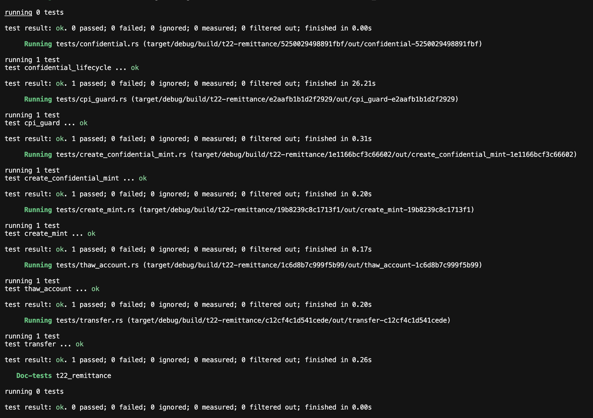

# Week 4 Assignment (Token-2022)

The goal of this assignment is to issue a remittance stablecoin using Token-2022 extensions. The token needs a fee on every transfer, new accounts that stay frozen until KYC clears, a pointer to on-chain metadata, and the ability to close the mint if it is ever decommissioned.

Part 1, the public mint:

1. Create a mint with four extensions: TransferFeeConfig, MetadataPointer (pointed at the mint itself), DefaultAccountState (frozen) and MintCloseAuthority.
2. Write a transfer instruction that uses `transfer_checked_with_fee`, with the fee worked out by `calculate_epoch_fee`.
3. Read mint and token account state only through `StateWithExtensions`.
4. Write the unfreeze path, where the freeze authority thaws one account after "KYC".

Part 2, the re-issued mint:

5. Re-issue the mint with the same extensions, plus PermanentDelegate and confidential transfers with manual approval.
6. Implement the confidential lifecycle: configure, deposit, apply pending balance, transfer and withdraw.

And optionally:

7. Build a program that receives delegated authority through Approve and transfers on the user's behalf. The user then enables CPI Guard, and the already-delegated transfer should still work.

Parts 1 and 2 and the optional step are complete and covered below.

The program is called `t22_remittance` and lives in `programs/t22-remittance`. In the code, `t22_remittance::` is this program and `anchor_spl::token_2022::` is the official Token-2022 program.

## Results (Part 1)

### **Step 1:** Setting up the workspace

- Created the Anchor workspace with `anchor init` and removed the default counter template
- `anchor-spl` is used with the `token_2022` and `token_2022_extensions` features
- The Rust toolchain is set to `stable` in `rust-toolchain.toml`. It was pinned to 1.89 at first, then moved to stable so the tests could use the newer libraries that confidential transfers need (see Part 2, step 3)
- Each instruction has its own file in `src/instructions/`, and `src/lib.rs` only holds the entry points

### **Step 2:** Create mint

- `src/instructions/create_mint.rs` creates the mint with all four extensions
- Both the payer and the mint sign. The mint account does not exist yet, so its signature proves ownership of the address it will be created at
- The creation order is the same for every Token-2022 mint:
  1. List the extensions
  2. Work out the account size with `ExtensionType::try_calculate_account_len`
  3. Create the account at that size, owned by the Token-2022 program, with a CPI to the System Program
  4. Initialize each extension
  5. Call `initialize_mint2` last
- The four extensions are set up as follows:
  - MintCloseAuthority: the payer can close the mint
  - MetadataPointer: the metadata address is the mint itself
  - DefaultAccountState: every new token account starts frozen
  - TransferFeeConfig: 100 basis points (1%), capped at 1,000,000 base units (1 token)
- `initialize_mint2` sets 6 decimals and makes the payer both the mint authority and the freeze authority
  - A freeze authority is required here. Without one, nobody could thaw the accounts that start frozen

### **Step 3:** Thaw account

- `src/instructions/thaw_account.rs` unfreezes one token account. This is the "KYC" gate
- Four accounts are needed: the freeze authority (signer), the mint, the token account (`mut`) and the Token-2022 program
- The instruction is a single CPI to Token-2022's `thaw_account`
- Token-2022 checks that the signer matches the freeze authority stored on the mint, so nobody else can thaw an account
- Freeze and thaw are basic token program features. The extension only adds the rule that new accounts start frozen
- Thawing changes one token account. The mint's default stays frozen, so the next new account is still locked

### **Step 4:** Transfer with fee

- `src/instructions/transfer.rs` moves tokens from one token account to another and takes the amount as an argument
- Five accounts are needed: the sender (signer), the mint, the `from` and `to` token accounts (both `mut`) and the Token-2022 program
- The function does three things:
  1. Reads the mint's raw bytes and decodes them with `StateWithExtensions`, then pulls out `TransferFeeConfig`
  2. Gets the current epoch from the Clock sysvar and works out the fee with `calculate_epoch_fee(epoch, amount)`
  3. Calls `transfer_checked_with_fee` with the amount, the mint's decimals and that fee
- The fee is worked out at the current epoch instead of using a stored rate, because a fee change only takes effect at a later epoch
- Token-2022 rejects the transfer if the stated fee does not match the mint's rule
- The fee is not sent to the issuer during the transfer. It is withheld inside the recipient's token account until the issuer collects it

### **Step 5:** Testing with LiteSVM

- There is one test file per instruction in `tests/` for Part 1, and each test starts from a fresh LiteSVM chain
- `tests/common/mod.rs` holds two helpers shared between tests:
  - `setup()` starts the chain, loads the program from `target/deploy/t22_remittance.so`, airdrops 1 SOL to a new payer and creates the mint. It returns the chain, the payer and the mint
  - `create_thawed_account()` opens an Associated Token Account for a wallet, thaws it and returns its address
- All state is read back through `StateWithExtensions`, for both the mint and token accounts
- `tests/create_mint.rs` creates the mint and checks:
  - The account exists, is owned by Token-2022 and has 6 decimals
  - All four extensions are on the mint
  - The default account state is frozen
  - The metadata pointer points at the mint
  - The close authority is the payer
  - The fee is 100 basis points with a maximum of 1,000,000
- `tests/thaw_account.rs` opens a token account for a new user and checks:
  - The account starts frozen
  - After the thaw instruction, its state is `Initialized`
- `tests/transfer.rs` thaws a sender and a recipient, mints 1,000 tokens to the sender and transfers 100. It checks:
  - The sender has 900 tokens left
  - The recipient has 99 usable tokens
  - 1 token is withheld as the fee in the recipient's token account

## Results (Part 2)

### **Step 1:** Create confidential mint

- `src/instructions/create_confidential_mint.rs` creates the second mint. Confidential transfers cannot be added to a mint after it is created, so this is a new mint and not a change to the first one
- It follows the same creation order as the first mint, with seven extensions instead of four:
  - The four from Part 1: TransferFeeConfig, MetadataPointer, DefaultAccountState and MintCloseAuthority
  - PermanentDelegate: the payer can move or burn tokens from any account of this mint. This is the seizure authority
  - ConfidentialTransferMint: turns on hidden balances and transfer amounts
  - ConfidentialTransferFeeConfig: handles the fee when the amount is hidden
- The task does not name ConfidentialTransferFeeConfig, but it is required. Token-2022 refuses to create a mint that has both a transfer fee and confidential transfers without it
- Anchor has no helper for the two confidential extensions, so each is done in two steps: build the instruction, then send it to Token-2022 with `invoke`
- Confidential transfers are set up with `auto_approve_new_accounts = false`. This is the manual approval policy: the issuer must approve each account before it can use hidden balances
- The instruction takes one argument, `fee_elgamal_pubkey`, which is the public half of the issuer's fee encryption key
  - Withheld fees on this mint are encrypted with it, so only the issuer can read how much has been collected
  - The key pair is made off chain and only the public half is passed in, because the secret half must never be on chain
- ConfidentialTransferFeeConfig is initialized after ConfidentialTransferMint, because Token-2022 checks the first one is already on the mint

### **Step 2:** Deposit and apply pending balance

- These are the two confidential actions a program can drive on its own, because they need no proofs
- `src/instructions/deposit.rs` moves tokens from a token account's public balance into its hidden balance
  - Four accounts are needed: the owner (signer), the mint, the token account (`mut`) and the Token-2022 program
  - It builds Token-2022's confidential `deposit` instruction and sends it with `invoke`. The owner's signature carries through
  - No proof is needed, as the amount was already public before the deposit
- `src/instructions/apply_pending_balance.rs` moves the pending balance into the available balance
  - Three accounts are needed: the owner (signer), the token account (`mut`) and the Token-2022 program
  - It takes two arguments: the pending credit counter the owner has accounted for, and the new available balance encrypted with the owner's AES key
  - The owner supplies the new balance because Token-2022 cannot read the amounts, so it cannot update that copy itself
- Deposits and incoming transfers land in the pending balance first and cannot be spent until they are applied

### **Step 3:** Updating the test libraries

- Configure, transfer and withdraw each need a zero-knowledge proof, which is built in the test and checked on chain by the ZK ElGamal Proof program
- With the original versions, the proofs built by the test were rejected by the proof program inside the test chain, because the two were built on different versions of the encryption library
- The test dependencies were updated to a matching set: `litesvm` 0.16 and `solana-zk-sdk` 7, plus `spl-token-2022-interface` 3.1 and the proof generation and proof extraction libraries
- The Rust toolchain was moved from 1.89 to `stable` for the same reason
- These are all `[dev-dependencies]`, so they are only used by the tests and are not part of the compiled program

### **Step 4:** Testing the confidential mint and lifecycle

- `tests/create_confidential_mint.rs` creates the second mint and checks:
  - All seven extensions are on the mint
  - The permanent delegate is the payer
  - `auto_approve_new_accounts` is false
- `tests/confidential.rs` runs the full lifecycle in one test, with a check after every stage:
  1. Create the confidential mint
  2. Create the user's token account by hand, sized for three extensions: TransferFeeAmount, ConfidentialTransferAccount and ConfidentialTransferFeeAmount
  3. Configure: the user's ElGamal and AES keys are derived from their wallet, and a proof shows they hold the ElGamal secret key. The user signs, as only the owner can configure their account. The account is then checked to be not yet approved
  4. Approve: the issuer approves the account, and it is checked to be approved
  5. Thaw the account and mint 100,000 base units of public tokens to it
  6. Deposit through the program: pending is 100,000 and available is 0
  7. Apply pending through the program: pending is 0 and available is 100,000
  8. Set up a recipient with their own configured, approved and thawed account
  9. Confidential transfer of 10,000: the sender has 90,000 left, the recipient has 9,900 in pending and the fee of 100 is withheld
  10. The recipient applies their pending balance, so the 9,900 is available
  11. Withdraw 1,000: the recipient's public balance is 1,000 and their hidden balance is 8,900
- The pending balance is applied before the withdraw, as a withdraw can only take from the available balance
- The transfer uses `transfer_with_fee`, because the mint charges a fee. It needs five proofs:
  - The sender has enough
  - The amount is encrypted correctly for the recipient
  - The fee is the right percentage and within the cap
  - The fee is encrypted correctly for the issuer
  - Every hidden number is a valid amount and not negative
- The five proofs do not fit in one transaction, so each is checked in its own transaction first and the result is stored in a small account. The transfer then points at those accounts, and they are closed afterwards to return the rent
- The withheld fee sits in the recipient's account but is encrypted with the issuer's fee key, so only the issuer can read it
- `tests/common/confidential_helpers.rs` holds the helpers for this test:
  - `send()` wraps instructions in a transaction, signs it and sends it
  - `read_confidential()`, `pending_balance()`, `available_balance()` and `withheld_fee()` read and decrypt balances
  - `apply_pending()` works out the new available balance and calls the program's `apply_pending_balance`
  - `create_confidential_account()` creates, configures, approves and thaws an account
  - `stage_proof()` and `close_contexts()` store a checked proof in its own account and close it afterwards
- Configure, approve, transfer and withdraw are sent straight to Token-2022 from the test. Deposit and apply pending go through the program

## Results (Optional)

### **Step 1:** Delegated transfer

- `src/instructions/delegated_transfer.rs` moves tokens out of a user's account using authority the user has delegated to the program
- The delegate is a PDA of the program with the seed `"delegate"`. It holds no data and is only used to sign
- The instruction works out the fee in the same way as `transfer`, then calls `transfer_checked_with_fee` with `CpiContext::new_with_signer` so the program signs for the PDA
- The user does not sign the transfer. Their approval was given earlier with Approve

### **Step 2:** Testing with CPI Guard

- `tests/cpi_guard.rs` uses the first mint, with a sender holding 1,000 tokens and a recipient:
  1. The sender approves the program's PDA as a delegate for up to 200 tokens, with a top-level Approve that they sign
  2. The program transfers 50 tokens. The recipient holds 49.5 after the fee
  3. The sender enables CPI Guard. The account is reallocated to fit the extension first, and the guard is then checked to be on
  4. The program transfers another 50 tokens. The recipient holds 99
- This shows that CPI Guard does not cancel a delegation the user had already given on purpose
- The second transfer is identical to the first, so the test moves to a new blockhash before sending it. The chain rejects an exact repeat of a transaction

## Running the tests

```bash
anchor build
cargo test
```

`anchor build` must run first, as the tests load the compiled program from `target/deploy/`. It also needs to be run again after any change to the program's source.

All 6 tests pass: `create_mint`, `thaw_account`, `transfer`, `create_confidential_mint`, `confidential_lifecycle` and `cpi_guard`. The confidential test takes about 30 seconds, as building the proofs is heavy work.


